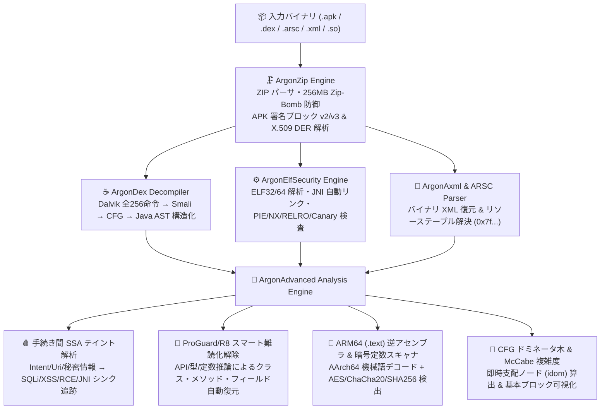
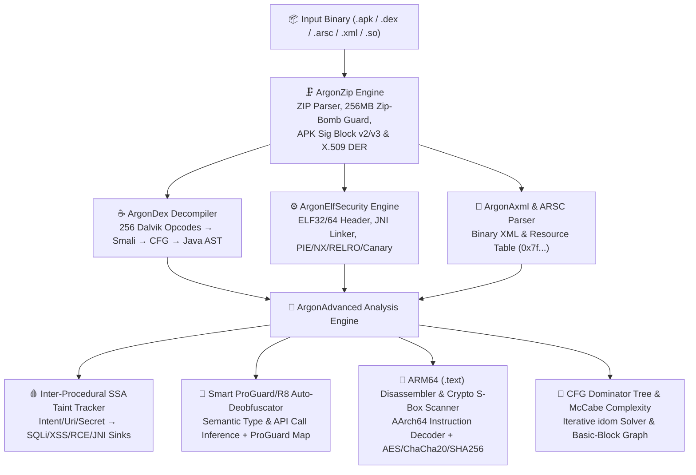

<div align="center">
  
  <h1>ArgonDEX Studio</h1>
  <p>
    <strong>次世代 Android APK 深層逆コンパイラ・Java AST 復元・SSA テイント解析・ARM64 ネイティブ解析統合 IDE</strong><br/>
    <em>Next-Generation Android APK Deep Decompiler, Dalvik-to-Java AST Reconstructor, Inter-Procedural SSA Taint Engine &amp; Native ARM64 Binary Security IDE</em>
  </p>
  <p>
    
    
    
    
  </p>
  <p>
    <a href="#-日本語ドキュメント-japanese"><strong>🇯🇵 日本語ドキュメント</strong></a> &nbsp;|&nbsp;
    <a href="#-english-documentation"><strong>🇺🇸 English Documentation</strong></a>
  </p>
</div>

---

# 🇯🇵 日本語ドキュメント (Japanese)

## 概要

**ArgonDEX Studio** は、外部バイナリ依存ゼロでブラウザ上（Web IDE）およびコマンドライン（Headless CLI）の両方で動作する、**Android APK 深層リバースエンジニアリング＆静的セキュリティ解析スイート**です。

生の `.apk` / `.dex` / `AndroidManifest.xml`（バイナリ AXML）/ `resources.arsc` / `.so`（ELF32/ELF64 ネイティブライブラリ）をバイトストリームから直接解析し、**可読性の高い Java ソースコード（AST 構造化復元）**、**Smali アセンブリ**、**制御フローグラフ（CFG）**、**手続き間 SSA テイント伝播経路（Source-to-Sink）**、**ProGuard/R8 スマート難読化自動解除**、および **ARM64 (AArch64) 機械語逆アセンブリ**を一気通貫で実行します。

---

## システムアーキテクチャ



---

## 主要機能一覧

| モジュール | 実装ファイル | 主な解析能力・特徴 |
| :--- | :--- | :--- |
| **バイナリアーカイブ＆署名検証エンジン** | `js/zip_engine.js` | Pure-JS ZIP パーサ／ビルダ、RFC 1951 INFLATE（**256 MB Zip-Bomb 防御上限付き**）、Shannon エントロピー計算、**APK Signature Scheme v2/v3** (`APK Sig Block 42`) 解析、**X.509 / PKCS#7 DER 証明書**デコーダ。 |
| **バイナリ XML & リソーステーブル復元** | `js/axml_arsc_parser.js` | コンパイル済み `AndroidManifest.xml` やレイアウト XML (`0x00080003`) を完全な XML テキストへ復元。`resources.arsc` (`0x000C0002`) を解析し、コード中の `0x7fXXXXXX` 定数を `@string/...` や `R.layout...` へ自動変換。 |
| **Dalvik → Java AST 逆コンパイラ** | `js/dex_decompiler.js` | Dalvik 全256オペコード対応の `.smali` 逆アセンブラ、基本ブロック CFG 構築、および構造化 **Java AST 逆コンパイラ**（`if`/`else`/`while`/`switch`/`try-catch`・**`synchronized` ブロック**・**短絡論理式 `&&`/`\|\|`**・**`fill-array-data` 配列リテラル**・**Java 8+ `invoke-custom` ラムダ式**復元、`StringBuilder` 連結畳み込み、遅延メモ化キャッシュ）。 |
| **多段 Worklist SSA テイント解析 & 文字列復号・難読化解除** | `js/advanced_analysis_engine.js` | **多段不動点 Worklist SSA テイントエンジン（最大6ホップ）**：汚染源からヘルパーメソッド・フィールドを跨いで危険なシンクまでの伝播を完全追跡。<br>**Dalvik 静的 XOR 文字列復号エミュレータ**：`fill-array-data` + `xor-int` による暗号化バイト配列を静的エミュレートして平文を自動復号。<br>**ProGuard/R8 スマート難読化解除** & **Frida 動的フックスクリプト (`frida_argon_hooks.js`) 自動生成**。 |
| **ネイティブ ELF & ARM64 → Pseudo-C デコンパイラ** | `js/elf_security_engine.js`<br>`js/advanced_analysis_engine.js` | 32/64-bit `.so` 解析、**PIE / NX / Full RELRO / Stack Canary / FORTIFY** 判定、JNI 自動リンク、**シンボル解決付き ARM64 (`.text`) 機械語逆アセンブラ**、**ARM64 → Pseudo-C（疑似C言語）構造化デコンパイラ**、および **AES S-Box / ChaCha20 / SHA-256** 暗号定数スキャナ。 |
| **OWASP MASVS 静的セキュリティ監査** | `js/elf_security_engine.js` | Manifest 設定不備、ハードコードされた秘密鍵、脆弱な暗号モード（`AES/ECB`）、SQLi、WebView ブリッジ、ネイティブ保護欠如を CVSS / CWE / OWASP MASVS 基準で自動スコアリング。 |

---

## クイックスタート (使い方)

### 1. インタラクティブ Web IDE の起動
モダンブラウザで `index.html` を直接開くか、付属のローカルサーバーを起動します。

```bash
python argondex_cli.py serve --port 8765 --open
```

起動すると、内蔵のバイナリショーケース APK **`ArgonVault_v2.4.1_sample.apk`** が自動合成・ロードされ、すぐに以下の全8モードを体験できます：
- **☕ Java & Smali Decompiler**：Java AST と Smali の並列表示、アドレス同期ハイライト、ワンクリック **「🧠 Smart Deobfuscate（難読化解除）」** トグル
- **🕸️ Control Flow & Call Graph**：**McCabe 循環的複雑度**・**即時支配ノード (`idom`)** バッジ付きインタラクティブ SVG フローグラフ
- **🧬 Taint & Deobfuscation**：Source-to-Sink のレジスタ単位トレースと難読化シンボル対応表
- **⚙️ Native ELF (.so) Inspector**：**ARM64 `.text` 機械語逆アセンブリ**と暗号 S-Box 定数検出

### 2. コマンドライン (CLI) による一括逆コンパイル＆監査
任意の `.apk` を Gradle 互換ディレクトリ構成（`src/main/java/...`, `smali/...`, `AndroidManifest.xml`, `resources_table.json`, `security_audit_report.json`）へ一括展開します。

```bash
# サンプル APK バイナリの生成
python argondex_cli.py generate-sample --out ./ArgonVault_v2.4.1_sample.apk

# APK の一括逆コンパイルと JSON セキュリティ監査レポート出力
python argondex_cli.py decompile ./ArgonVault_v2.4.1_sample.apk --out ./decompiled_out
```

---

## デバッグ＆自己防衛セキュリティ検証（悪意ある APK への対策）

リバースエンジニアリングツール自体を攻撃する悪意ある APK（Malicious APK）を想定し、以下の脆弱性対策を実装・自動テスト済みです。

```bash
# 全18ステージの機能・セキュリティ・構造化デバッグ自動検証スイートの実行
node tests/test_suite.js
```

1. **DOM XSS 完全防御 (`js/app.js`)**：クラス名・メソッド名・文字列リテラル・XML 属性内の `&`, `<`, `>`, `"`, `'` をすべてエスケープし、属性ブレイクアウトおよびスクリプト注入を遮断。
2. **Zip-Slip / パストラバーサル防止 (`js/dex_decompiler.js`, `argondex_cli.py`)**：`L../../../../etc/passwd;` のような悪意あるクラス記述子を `ArgonDex.sanitizeClassPath()` で無害化し、さらに CLI 出力時は `safeWriteFile()` で `path.resolve()` が `--out` ディレクトリ配下に収まることを強制検証。
3. **Zip-Bomb メモリ枯渇防御 (`js/zip_engine.js`)**：RFC 1951 INFLATE 展開器に **256 MB (`MAX_INFLATE_BYTES`)** のハードリミットを実装。
4. **破損チャンク・不正 LEB128 による無限ループ防止 (`js/axml_arsc_parser.js`, `js/dex_decompiler.js`)**：チャンクサイズ `cSize < 8` やファイル末尾超過を即座に検知して中断するガード、および ULEB128/SLEB128 の5バイト上限チェックを実装。
5. **正規表現インジェクション防止 & コンストラクタ保護 (`js/advanced_analysis_engine.js`)**：難読化識別子に含まれる正規表現メタ文字を `escapeRegExp()` でエスケープし、コンストラクタ宣言と一般メソッド宣言の置換競合を分離。

---

## Phase 1〜3 高度化アップデート＆構造化デバッグ出力例

### 1. 難読化解除 ＋ `synchronized` 復元 ＋ 暗号化バイト配列の静的 XOR 復号 (`CryptoTokenHelper.java`)
`com.argon.vault.obf.a` に対するスマート難読化解除、`monitor-enter/exit` からの `synchronized` ブロック復元、および `fill-array-data` + `xor-int/lit8` の静的エミュレーション復号結果：

```java
// [ArgonDEX Smart Deobfuscator] Renamed class 'com.argon.vault.obf.a' -> 'com.argon.vault.obf.CryptoTokenHelper' (Invokes javax.crypto.Cipher / MessageDigest APIs)
public final class CryptoTokenHelper /* obf: a */ {
    private String mString_a;
    private int mint_b;

    public CryptoTokenHelper() {
        this.mString_a = "AES/ECB/PKCS5Padding";
        this.mint_b = 256;
    }

    public byte[] transformCrypto_a(String arg0) {
        synchronized (this) {
            Cipher v0 = Cipher.getInstance(this.mString_a);
        }
        return NativeBridge.deriveHardwareKey(arg0, this.mint_b);
    }

    public int computeInt_b(int arg0, int arg1) {
        byte[] v0 = new byte[]{ 0x1b, 0x08, 0x1d, 0x15, 0x14, 0x05, 0x11, 0x1f, 0x03, 0x7b } /* 🔓 Decrypted XOR Byte-Array (key=0x5a): "ARGON_KEY!" */;
        return ((arg0 + arg1) * 31);
    }
}
```

### 2. ループヘッダ条件畳み込み (`while (v0 < arg1)`) と SQLi パラメータ汚染追跡
- **ループ条件畳み込み (`CryptoEngine.computeRollingHash`)**：ループ先頭の脱出分岐命令 (`if-ge`) を検出し、`while (true) { if (v0 >= arg1) break; ... }` ではなく自然な `while (v0 < arg1) { ... }` へ構造化。
- **SQL インジェクション汚染源の厳密帰属 (`VaultDatabase.queryVaultSecret`)**：SQL クエリ文字列定数と外部パラメータ (`arg1`) が `StringBuilder.append` で結合される際、外部パラメータ側のテイントを優先伝播し、`Method Parameter arg1 -> SQLiteDatabase.rawQuery (CWE-89)` を正確に検出。

### 3. ARM64 (`.text`) → Pseudo-C 構造化デコンパイル (`native_pseudo_c/libnative-vault.so.c`)
```c
// @vaddr 0x00001000
JNIEXPORT jint JNICALL JNI_OnLoad(JavaVM* vm /* x0 */, void* reserved /* x1 */) {
    return 0x10006 /* JNI_VERSION_1_6 */;
}

// @vaddr 0x00001010
JNIEXPORT uint64_t JNICALL Java_com_argon_vault_NativeBridge_deriveHardwareKey(JNIEnv* env /* x0 */, jobject thiz /* x1 */, uint64_t arg0 /* x2 */, uint64_t arg1 /* x3 */) {
    uint64_t x19 = env;
    uint64_t x20 = arg0;
    uint64_t v_1020 = (x19 ^ x20);
    uint64_t call_1024 = sub_1034_internal(v_1020, thiz);
    return call_1024;
}
```

---
---

# 🇺🇸 English Documentation

## Overview

**ArgonDEX Studio** is a zero-dependency, browser-native and CLI-enabled Android reverse engineering and static security analysis suite. It parses raw `.apk`, `.dex`, `AndroidManifest.xml` (binary AXML), `resources.arsc`, and native `.so` (ELF32/ELF64) binaries directly from byte buffers, reconstructing readable **Java source code**, **Smali assembly**, **Control Flow Graphs (CFG)**, **SSA Source-to-Sink Taint Flows**, **Smart ProGuard/R8 Deobfuscated Source**, and **ARM64 (AArch64) machine code disassembly**.

---

## System Architecture



---

## Key Capabilities

| Module | File | Highlights |
| :--- | :--- | :--- |
| **Binary Archive & Signing Engine** | `js/zip_engine.js` | Pure-JS ZIP parser/builder, RFC 1951 INFLATE with **256 MB Zip-Bomb protection**, Shannon entropy analyzer, **APK Signature Scheme v2/v3** (`APK Sig Block 42`) verifier, and **X.509 / PKCS#7 DER certificate** parser. |
| **Binary XML & Resource Decoder** | `js/axml_arsc_parser.js` | Decodes compiled `AndroidManifest.xml` and layout XMLs (`0x00080003`), parses `resources.arsc` (`0x000C0002`), and resolves `0x7fXXXXXX` IDs into `@string/...` / `R.layout...` references. |
| **Dalvik-to-Java AST Decompiler** | `js/dex_decompiler.js` | Full Dalvik 256-opcode disassembler (`.smali`), Basic-Block Control Flow Graph builder, and structured **Java AST decompiler** (`if`/`else`/`while`/`switch`/`try-catch`, **`synchronized` blocks**, **short-circuit `&&`/`\|\|`**, **`fill-array-data` initializers**, **Java 8+ `invoke-custom` lambdas**, `StringBuilder` folding, and memoized lazy evaluation). |
| **Multi-Hop SSA Taint, XOR String Decryptor & Frida Generator** | `js/advanced_analysis_engine.js` | **Fixed-Point Worklist Inter-Procedural SSA Taint Engine (6-hop)** tracking untrusted inputs across methods/fields to sinks. **Dalvik Static XOR String Decryptor** emulating encrypted byte arrays. **Smart ProGuard/R8 Deobfuscator** and **Automated Frida Hook Script Generator (`frida_argon_hooks.js`)**. |
| **Native ELF & ARM64-to-Pseudo-C Decompiler** | `js/elf_security_engine.js`<br>`js/advanced_analysis_engine.js` | Parses 32/64-bit `.so` libraries, checks **PIE / NX / Full RELRO / Stack Canary / FORTIFY**, links JNI symbols, disassembles **ARM64 (`.text`) machine code** with symbol target resolution, **decompiles ARM64 to structured Pseudo-C**, and scans for **AES Rijndael S-Box / ChaCha20 / SHA-256** binary constants. |
| **OWASP MASVS Security Auditor** | `js/elf_security_engine.js` | Automated CVSS/CWE/OWASP MASVS scoring across manifest configurations, hardcoded secrets, weak cryptography (`AES/ECB`), SQL injection, WebView bridges, and native memory mitigations. |

---

## Quick Start

### 1. Launch Interactive Web IDE
Open `index.html` directly in any modern browser, or start the local studio server:

```bash
python argondex_cli.py serve --port 8765 --open
```

### 2. Headless CLI Decompilation & Security Audit
Decompile any `.apk` into a structured Gradle-style directory (`src/main/java/...`, `smali/...`, `AndroidManifest.xml`, `resources_table.json`, and `security_audit_report.json`):

```bash
# Generate the sample showcase APK binary
python argondex_cli.py generate-sample --out ./ArgonVault_v2.4.1_sample.apk

# Decompile APK to Java, Smali, XML, and JSON Security Audit Report
python argondex_cli.py decompile ./ArgonVault_v2.4.1_sample.apk --out ./decompiled_out
```

---

## Debugging & Self-Vulnerability Hardening Verification

Run the automated 18-stage verification suite:

```bash
node tests/test_suite.js
```

1. **DOM XSS Prevention (`js/app.js`)**: All decompiled identifiers, string literals, XML attributes, and cross-reference attributes are sanitized for `&`, `<`, `>`, `"`, and `'`.
2. **Zip-Slip / Path Traversal Guard (`js/dex_decompiler.js`, `argondex_cli.py`)**: `ArgonDex.sanitizeClassPath()` strips `..` segments and invalid path characters, and `safeWriteFile()` enforces canonical `path.resolve()` containment inside `--out`.
3. **Zip-Bomb Decompression Ceiling (`js/zip_engine.js`)**: RFC 1951 INFLATE enforces a hard `256 MB` (`MAX_INFLATE_BYTES`) allocation ceiling.
4. **Malformed Binary Chunk & LEB128 Bounds (`js/axml_arsc_parser.js`, `js/dex_decompiler.js`)**: Strict header size guards (`cSize >= 8`, `offset + cSize <= bytes.length`) and 5-byte ULEB128/SLEB128 bounds prevent infinite loops on corrupted or adversarial DEX/AXML/ARSC headers.
5. **Deobfuscator RegExp Escaping & Constructor Isolation (`js/advanced_analysis_engine.js`)**: Escapes regex metacharacters in obfuscated identifiers and isolates class constructor renaming from method renaming.
6. **Phase 1–3 Advanced Verification (`tests/test_suite.js` Stages 14–18)**: Verifies `synchronized (this)` recovery, `while (v0 < arg1)` loop header condition folding, `fill-array-data` + XOR static string decryption (`"ARGON_KEY!"`), ARM64 `BL` symbol resolution, ARM64-to-Pseudo-C decompilation (`0x10006 /* JNI_VERSION_1_6 */`), automated Frida hook script generation (`frida_argon_hooks.js`), and SQLi parameter taint attribution.

---

## Project Structure / ディレクトリ構成

```text
ArgonDEX-Studio/
├── index.html                      # 8-Mode Dark-Glass Web IDE (ブラウザ統合開発環境)
├── argondex_cli.py                 # Headless Python + Node.js CLI Decompiler & Web Server
├── ArgonVault_v2.4.1_sample.apk    # Pre-built multi-layer binary showcase APK (検証用サンプルAPK)
├── GEMINI.md                       # Structured thinking & root-cause debugging guide (思考・デバッグ指針)
├── assets/
│   ├── icon.svg                    # Vector application icon (SVG)
│   ├── icon.png                    # High-resolution application icon (PNG)
│   └── icon.jpg                    # High-resolution application icon (JPEG)
├── css/
│   └── styles.css                  # IDE dark-glass styling & layout
├── js/
│   ├── zip_engine.js               # ZIP/APK parser, INFLATE, v2/v3 Signing Block, X.509 DER
│   ├── axml_arsc_parser.js         # Binary AXML & resources.arsc decoder
│   ├── dex_decompiler.js           # Dalvik parser, Smali disassembler, CFG & Java AST engine
│   ├── elf_security_engine.js      # ELF32/64 parser, JNI linker & OWASP MASVS auditor
│   ├── advanced_analysis_engine.js # Worklist SSA Taint, XOR Decryptor, ARM64 Pseudo-C & Frida Gen
│   ├── sample_apk_builder.js       # Binary APK synthesizer (DEX + AXML + ARSC + ELF64 + Cert)
│   └── app.js                      # IDE controller, syntax highlighters, SVG CFG & exporter
├── tests/
│   └── test_suite.js               # 18-stage functional, decompiler & security test suite
└── decompiled_out/                 # Reference CLI output (Java, Smali, Pseudo-C, Frida hooks, JSON)
```
