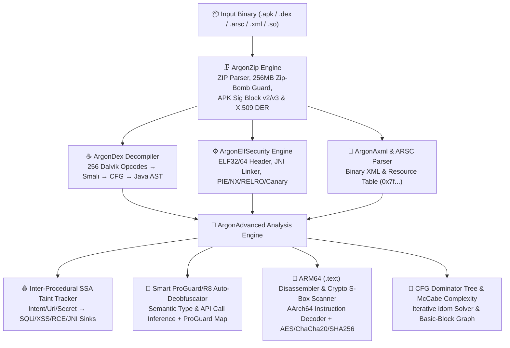

<div align="center">
  
  <h1>ArgonDEX Studio</h1>
  <p><strong>Next-Generation Android APK Deep Decompiler, Dalvik-to-Java AST Reconstructor, Inter-Procedural SSA Taint Engine &amp; Native ARM64 Binary Security IDE</strong></p>
  <p>
    
    
    
    
  </p>
</div>

---

## Overview

**ArgonDEX Studio** is a zero-dependency, browser-native and CLI-enabled Android reverse engineering and static security analysis suite. It parses raw `.apk`, `.dex`, `AndroidManifest.xml` (binary AXML), `resources.arsc`, and native `.so` (ELF32/ELF64) binaries directly from byte buffers, reconstructing readable **Java source code**, **Smali assembly**, **Control Flow Graphs (CFG)**, **SSA Source-to-Sink Taint Flows**, **Smart ProGuard/R8 Deobfuscated Source**, and **ARM64 (AArch64) machine code disassembly**.

---

## System Architecture



---

## Key Capabilities

| Module | File | Highlights |
| :--- | :--- | :--- |
| **Binary Archive & Signing Engine** | `js/zip_engine.js` | Pure-JS ZIP parser/builder, RFC 1951 INFLATE with **256 MB Zip-Bomb protection**, Shannon entropy analyzer, **APK Signature Scheme v2/v3** (`APK Sig Block 42`) verifier, and **X.509 / PKCS#7 DER certificate** parser. |
| **Binary XML & Resource Decoder** | `js/axml_arsc_parser.js` | Decodes compiled `AndroidManifest.xml` and layout XMLs (`0x00080003`), parses `resources.arsc` (`0x000C0002`), and resolves `0x7fXXXXXX` IDs into `@string/...` / `R.layout...` references. |
| **Dalvik-to-Java AST Decompiler** | `js/dex_decompiler.js` | Full Dalvik 256-opcode disassembler (`.smali`), Basic-Block Control Flow Graph builder, and structured **Java AST decompiler** (`if`/`else`/`while`/`switch`/`try-catch` recovery, `StringBuilder` chain folding, `new` constructor folding). |
| **SSA Taint & Smart Deobfuscator** | `js/advanced_analysis_engine.js` | **Inter-Procedural SSA Taint Engine** tracking untrusted inputs (`Intent`, `Uri`, credentials) to critical sinks (`SQLiteDatabase.rawQuery`, `WebView.loadUrl`, `Runtime.exec`, JNI). **Smart ProGuard/R8 Deobfuscator** with live Java AST rewriting and ProGuard `mapping.txt` export. |
| **Native ELF & ARM64 Disassembler** | `js/elf_security_engine.js`<br>`js/advanced_analysis_engine.js` | Parses 32/64-bit `.so` libraries, checks **PIE / NX / Full RELRO / Stack Canary / FORTIFY**, links `Java_pkg_Class_method` symbols to Java `native` declarations, disassembles **ARM64 (`.text`) machine code**, and scans for **AES Rijndael S-Box / ChaCha20 / SHA-256** binary constants. |
| **OWASP MASVS Security Auditor** | `js/elf_security_engine.js` | Automated CVSS/CWE/OWASP MASVS scoring across manifest configurations, hardcoded secrets, weak cryptography (`AES/ECB`), SQL injection, WebView bridges, and native memory mitigations. |

---

## Quick Start

### 1. Launch Interactive Web IDE
Open `index.html` directly in any modern browser, or start the local studio server:

```bash
python argondex_cli.py serve --port 8765 --open
```

The Web IDE automatically synthesizes and loads the built-in showcase binary **`ArgonVault_v2.4.1_sample.apk`** on startup so you can immediately explore:
- **Side-by-side Java AST & Smali Decompiler** (with click-to-sync bytecode addresses and a **🧠 Smart Deobfuscate** toggle)
- **Control Flow Graph (CFG)** with **McCabe Cyclomatic Complexity** and **Immediate Dominator (`idom`)** badges
- **🧬 Taint & Deobfuscation Workbench** showing full register-by-register SSA propagation traces
- **⚙️ Native ELF (`libnative-vault.so`) Inspector** with **ARM64 `.text` disassembly** and **Crypto Constant S-Box** hits

### 2. Headless CLI Decompilation & Security Audit
Decompile any `.apk` into a structured Gradle-style directory (`src/main/java/...`, `smali/...`, `AndroidManifest.xml`, `resources_table.json`, and `security_audit_report.json`):

```bash
# Generate the sample showcase APK binary
python argondex_cli.py generate-sample --out ./ArgonVault_v2.4.1_sample.apk

# Decompile APK to Java, Smali, XML, and JSON Security Audit Report
python argondex_cli.py decompile ./ArgonVault_v2.4.1_sample.apk --out ./decompiled_out
```

---

## Debugging & Self-Vulnerability Hardening Verification

ArgonDEX Studio is hardened against maliciously crafted APK binaries designed to exploit reverse-engineering tools (e.g., Zip-Slip path traversal, Zip-Bombs, infinite-loop chunk headers, malformed LEB128 streams, and DOM XSS via malicious class/string names).

Run the automated 13-stage verification suite:

```bash
node tests/test_suite.js
```

### Verified Security Controls
1. **DOM XSS Prevention (`js/app.js`)**: All decompiled identifiers, string literals, XML attributes, and cross-reference attributes are sanitized for `&`, `<`, `>`, `"`, and `'`.
2. **Zip-Slip / Path Traversal Guard (`js/dex_decompiler.js`, `argondex_cli.py`)**: `ArgonDex.sanitizeClassPath()` strips `..` segments and invalid path characters, and `safeWriteFile()` enforces canonical `path.resolve()` containment inside `--out`.
3. **Zip-Bomb Decompression Ceiling (`js/zip_engine.js`)**: RFC 1951 INFLATE enforces a hard `256 MB` (`MAX_INFLATE_BYTES`) allocation ceiling.
4. **Malformed Binary Chunk & LEB128 Bounds (`js/axml_arsc_parser.js`, `js/dex_decompiler.js`)**: Strict header size guards (`cSize >= 8`, `offset + cSize <= bytes.length`) and 5-byte ULEB128/SLEB128 bounds prevent infinite loops on corrupted or adversarial DEX/AXML/ARSC headers.
5. **Deobfuscator RegExp Escaping & Constructor Isolation (`js/advanced_analysis_engine.js`)**: Escapes regex metacharacters in obfuscated identifiers and isolates class constructor renaming from method renaming.

---

## Project Structure

```text
ArgonDEX-Studio/
├── index.html                      # 8-Mode Dark-Glass Web IDE
├── argondex_cli.py                 # Headless Python + Node.js CLI Decompiler & Web Server
├── ArgonVault_v2.4.1_sample.apk    # Pre-built multi-layer binary showcase APK
├── GEMINI.md                       # Structured thinking & root-cause debugging guide
├── assets/
│   ├── icon.svg                    # Vector application icon
│   ├── icon.png                    # High-resolution application icon (PNG)
│   └── icon.jpg                    # High-resolution application icon (JPEG)
├── css/
│   └── styles.css                  # IDE dark-glass styling & layout
├── js/
│   ├── zip_engine.js               # ZIP/APK parser, INFLATE, v2/v3 Signing Block, X.509 DER
│   ├── axml_arsc_parser.js         # Binary AXML & resources.arsc decoder
│   ├── dex_decompiler.js           # Dalvik parser, Smali disassembler, CFG & Java AST engine
│   ├── elf_security_engine.js      # ELF32/64 parser, JNI linker & OWASP MASVS auditor
│   ├── advanced_analysis_engine.js # SSA Taint, Smart Deobfuscator, ARM64 Disasm & Crypto Scanner
│   ├── sample_apk_builder.js       # Binary APK synthesizer (DEX + AXML + ARSC + ELF64 + Cert)
│   └── app.js                      # IDE controller, syntax highlighters, SVG CFG & exporter
├── tests/
│   └── test_suite.js               # 13-stage functional & security vulnerability test suite
└── decompiled_out/                 # Reference CLI decompilation output for ArgonVault sample APK
```
